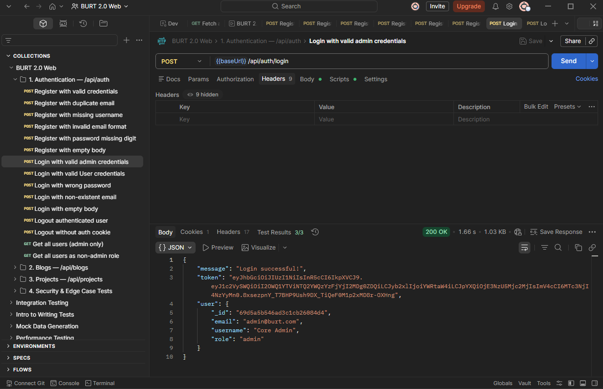

# 🧪 BURT QA Automation & Manual Testing Report Suite

## ⚠️ Security & Data Privacy Disclaimer
**Please Note:** The testing detailed in this report was conducted on a **backdated, early version** of the BURT platform in a staged demo environment. The current live website has since been updated, and the findings or defects listed here reflect historical development phases, not the present state of the system. 

All data used, executed, and displayed during these tests is sanitized "test data" corresponding to previously resolved issues. **No real, active, or sensitive user data is exposed in this repository**, ensuring complete compliance with data privacy and security standards. 

*Sensitive endpoints (such as the Admin Portal and Backend API Base URLs) have been redacted from this public document to prevent unauthorized probing.*

---

## 📌 Project Overview
This project presents a comprehensive Quality Assurance (QA) evaluation of the BRAC University Response Team (BURT) platform. It includes structured testing of:

* **🌐 Public Website:** UI/UX & Functional Testing
* **🔐 Admin Panel:** Navigation & Responsiveness
* **🔗 REST API:** Authentication & Validation Testing
* **⚙️ Automated API Execution:** using Postman, Newman, and Portman

The goal is to ensure the performance, reliability, security, and usability of the BURT system in a production-ready environment.

---

## 🌍 Applications Under Test

| Component | URL (Early Version / Demo) |
| :--- | :--- |
| **Public Website** | [https://www.bracurt.org/](https://www.bracurt.org/) |
| **Admin Panel** | `[Redacted for Security]` |
| **Backend API** | `[Redacted for Security] (Hosted on Render)` |

---

## 🎯 Testing Objectives
* Validate UI consistency and responsiveness across devices.
* Ensure navigation and user flows work correctly.
* Verify API authentication and validation rules.
* Identify functional and runtime defects.
* Measure system stability under real-world conditions.
* Generate automated API execution reports using Newman and Portman.

---

## 🧪 Testing Types Performed

### 1. 🌐 Manual UI Testing
* Homepage rendering & performance validation
* Navigation bar functionality
* Responsive design (Desktop, Tablet, Mobile)
* Logo redirect behavior
* Page load performance testing

### 2. 🔐 API Testing (Postman)
* User registration endpoint validation
* Authentication behavior testing
* Negative test cases (invalid input, missing fields)
* Duplicate data handling
* HTTP status code verification

### 3. ⚙️ Automated API Testing (Newman & Portman)
* Collection execution and automation using Portman
* HTML Extra report generation
* Assertion-based validation
* Regression execution testing

---

## 🛠 Tools & Technologies

* **🧾 Postman (v11.x):** API Testing & Collection Development
* **⚙️ Portman & Newman:** CLI Automation & Test Generation
* **📊 Newman HTML Extra Reporter:** Test Reporting
* **🌐 Google Chrome (Latest):** UI Validation
* **🖥 Windows 11:** Test Environment

---

## 📁 Project Structure

```text
BURT-QA-REPORT/
│
├── images/
│   └── portman.png
│
├── newman/
│   └── BURT 2.0 Web-2026-04-11-12-08-16-215-0.html
│
├── node_modules/
│
├── BURT 2.0 Web.postman_collection.json
├── Facebook QA.xlsx
├── Jira.csv
├── index.html
├── package.json
├── package-lock.json
├── LICENSE
└── README.md
```

---

## 📊 Manual QA Summary

### 🧾 Test Execution Overview

| Metric | Value |
| :--- | :--- |
| **Total Test Cases** | 85 |
| **Passed** | 76 |
| **Failed** | 9 |
| **Pending** | 0 |


### 📌 Key Findings
* ✅ Homepage loads in ~1.56 seconds (Excellent performance).
* ✅ UI layout is stable across screen sizes.
* ✅ Navigation system is fully functional.
* ⚠️ Minor functional defects identified in specific modules.

---

## 🔐 API Testing Summary

**Endpoint:** `/api/auth` *(Base URL Redacted)*

| Test Scenario | Expected Result | Actual Result | Status |
| :--- | :--- | :--- | :--- |
| **Valid user registration** | `201 Created` | Success | ✅ PASS |
| **Duplicate email** | `409 Conflict` | `502 Bad Gateway` | ❌ FAIL |
| **Missing username** | `400 Bad Request` | Correct response | ✅ PASS |
| **Invalid email format** | `400 Bad Request` | Correct response | ✅ PASS |

🔗 **Detailed Report:** [View Full Newman Execution Report](https://mdsayemmottakee.github.io/BURT-QA-Automation-Manual-Testing-Report-Suite)
---

## 🚨 Critical Defect Highlight

> ### ❗ API Instability Issue
> * **Endpoint:** `/api/auth/register` *(Base URL Redacted)*
> * **Issue:** Duplicate email request returns `502 Bad Gateway`
> * **Expected:** `409 Conflict`
> * **Severity:** 🔴 High
> 
> **Impact:**
> * Backend instability under edge cases.
> * Poor error handling implementation.
> * Potential production risk for the user registration flow.

---

## ⚙️ API Automation Execution

### ▶️ Execution Command
```bash
newman run "BURT 2.0 Web.postman_collection.json" -r htmlextra
```

### 📊 Execution Metrics

| Metric | Value |
| :--- | :--- |
| **Total Iterations** | 1 |
| **Total Assertions** | 54 |
| **Total Failed Tests** | 55 |
| **Total Skipped Tests** | 0 |

### ⚠️ Execution Analysis
* **Overall Execution Status:** ❌ FAILED
* High number of failed assertions detected.
* Indicates unstable API behavior or test script inconsistency.
* *Action Required:* Backend + Postman script review.

---

## 📸 Evidence & Artifacts

### Portman Execution Screenshot
Below is the execution verification demonstrating the use of Portman for our API test generation and automation setup:



* **📊 Newman HTML Report:** Found in the `newman/` directory.

---

## 📈 Performance Summary
* **⏱ Page Load Time:** ~1.56s
* **📉 LCP:** Optimized
* **📊 CLS:** Stable
* **⚡ Overall UX:** Good

---

## 👨‍💻 Author
**Ariful Islam** *QA Engineer | Automation & Manual Testing Enthusiast*

## 📅 Report Information

| Field | Value |
| :--- | :--- |
| **Version** | v2.0 |
| **Report Date** | April 08, 2026 |
| **Documentation Updated** | April 11, 2026 |
| **Environment** | Backdated Demo Environment |

---

## 🚀 Conclusion
The BURT platform demonstrated strong frontend stability, responsive UI design, and acceptable performance metrics during this testing phase. However, critical backend instability (`502` errors) and high API failure rates in negative test cases indicated an immediate need for backend improvements and better error handling before wider release (which have since been addressed in current live versions).
